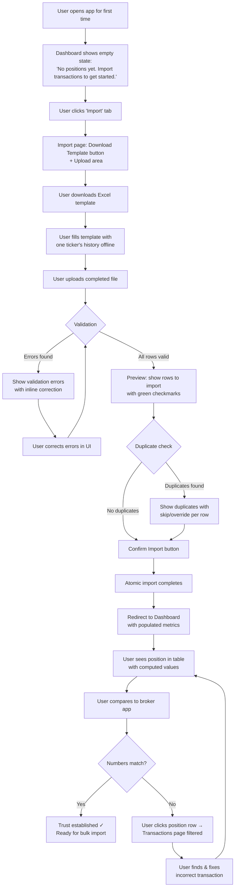
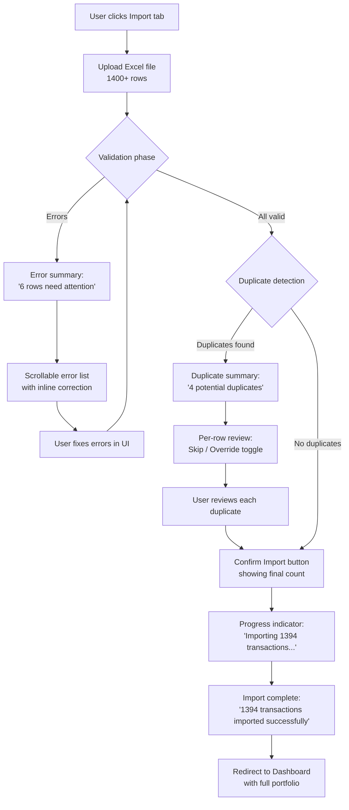
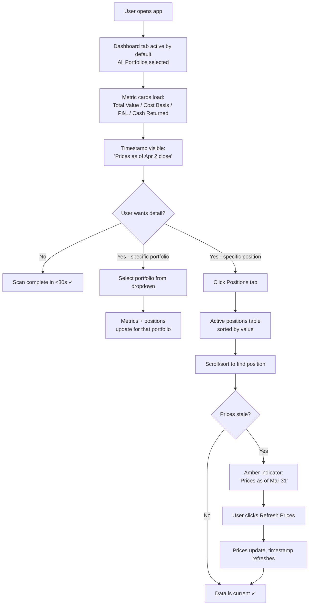
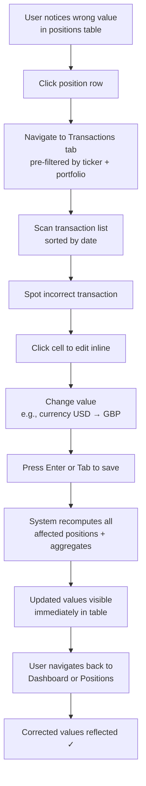

# UX Design Specification — Personal Portfolio Tracker

**Author:** Maksim
**Date:** 2026-04-03

---

## Executive Summary

### Project Vision

Personal Portfolio Tracker is a localhost web application that gives a self-directed investor a single, accurate, consolidated view of holdings spread across multiple brokerage accounts. The core architectural decision is trade-level reconstruction — positions are computed from historical buy/sell/dividend/fee transactions (event-sourced), not broker snapshots. Users import via a standardized Excel template (no broker credentials), and the FMP API provides live pricing and FX rates. All values normalize to USD.

The MVP delivers four core views: a Dashboard with aggregate and per-portfolio metrics, a Positions Table showing active and closed positions with computed columns, a Transactions Page serving as the source-of-truth ledger with inline editing, and an Import Page providing a multi-step import flow with validation, duplicate detection, and atomic commit.

### Target Users

Single user — the builder, Maksim. A self-directed investor managing positions across multiple brokers, intermediate technical skill, comfortable with Excel. Values accuracy above all, followed by data ownership and a seamless import experience. Desktop-only, Chrome-only. No accessibility or SEO requirements.

### Key Design Challenges

1. **Trust-building through transparency.** The entire value proposition depends on the user believing the numbers are correct. The UX must make calculations auditable — every number traceable back to the trades that produced it, with visible price/FX timestamps and clear staleness indicators.
2. **Complex import flow made simple.** The multi-step import (upload → validate → correct errors → review duplicates → commit) has high information density. It needs to feel guided, not overwhelming — especially for 1400+ row batches with mixed error types.
3. **Data-dense tables that stay readable.** The positions table has 10+ computed columns. The transactions ledger can have 1400+ rows. Maintaining scannability while supporting filtering, sorting, and inline editing is a core layout challenge.

### Design Opportunities

1. **Position drill-down as a trust mechanism.** Clicking a position to see its underlying transactions is both a power feature and a confidence builder — it lets the user audit any number on screen.
2. **Progressive disclosure in import.** Guiding the user through validation → correction → duplicate review as distinct steps (rather than dumping all issues at once) can turn a potentially stressful experience into a controlled, confident one.
3. **Dashboard as a 30-second check.** The daily portfolio check journey should require zero clicks beyond opening the app — aggregate view loads by default, key metrics are immediately visible, and stale data is flagged without obscuring the numbers.

## Core User Experience

### Defining Experience

The core loop is the **daily portfolio check** — open the app, scan the dashboard, glance at positions, done in 30 seconds. This is the most frequent interaction and the daily payoff that justifies the tool's existence.

The most critical action to get right is the **import flow**. If import fails or produces wrong numbers, the app is dead on arrival. Import is the gateway to trust — it only needs to work well a few times, but those times are make-or-break.

The one interaction that, if nailed, makes everything else follow: **seeing position numbers match broker statements exactly**. That moment of "the numbers are right" converts this from a project into a daily tool.

### Platform Strategy

- Localhost web application — no deployment, no auth, no network exposure
- Chrome-only — no cross-browser testing or compatibility concerns
- Desktop-only — mouse/keyboard interaction, no touch or responsive layout
- No offline needs — FMP API requires connectivity for live pricing
- No SEO — localhost, no server-side rendering needed
- No accessibility requirements — single-user personal tool

### Effortless Interactions

- **Opening the app** — aggregate dashboard loads immediately with no login, no loading wall. The full picture is visible on arrival.
- **Switching views** — moving between aggregate and per-portfolio views is a single click with no page reload.
- **Position drill-down** — clicking a position row navigates directly to its filtered transactions. The connection between summary and detail is seamless.
- **Error correction** — editing a transaction and seeing all downstream values recalculate instantly on save. No manual refresh, no stale state.
- **Import confidence** — each step of the import flow clearly shows what happened, what needs attention, and what comes next.

### Critical Success Moments

1. **First import verification** — the user imports one ticker's history, compares computed values to broker statements, and the numbers match exactly. Trust is established.
2. **Bulk import completion** — 1400+ rows import cleanly with clear error and duplicate handling. No silent data corruption. Confidence scales from one ticker to the full portfolio.
3. **30-second morning check** — open app, see aggregate metrics, scan positions, close app. The daily payoff that makes the tool indispensable.
4. **Error correction confidence** — edit a transaction, see all affected positions and aggregates recalculate immediately. The system feels alive, responsive, and trustworthy.

### Experience Principles

1. **Accuracy is the experience.** Every design decision serves number correctness and auditability. If the user can't trust the data, nothing else matters.
2. **Zero-friction daily use.** The aggregate dashboard loads instantly with no interaction required. The app earns its place by being faster than opening two broker apps.
3. **Guided complexity.** Import, validation, and error correction are inherently complex — the UX breaks them into clear, sequential steps where the user always knows what's happening and what's next.
4. **Transparency over polish.** Show timestamps, show staleness, show the math. The user would rather see "price as of Apr 2 close" than a pretty animation.

## Desired Emotional Response

### Primary Emotional Goals

**Confident control.** The user should feel like they have a firm, clear grip on their entire financial position. Not anxious, not overwhelmed — just quietly in command. The feeling of "I know exactly where I stand."

### Emotional Journey Mapping

| Moment | Desired Feeling | What Drives It |
|---|---|---|
| First open / setup | Clarity, low anxiety | Clean interface, obvious first step (download template) |
| First import | Cautious optimism → relief | Guided validation, no surprises, clear error messages |
| First number match vs broker | Trust, satisfaction | "The numbers are right" — the make-or-break moment |
| Bulk import | Confidence, control | Clear progress, manageable error handling, atomic commit |
| Daily check | Calm efficiency | Instant aggregate view, no clicks needed, fast scan |
| Error discovery | Brief concern → quick resolution | Position drill-down, inline edit, instant recomputation |
| Returning to the app | Familiarity, reliability | Same layout, same speed, data is always current |

### Micro-Emotions

**Critical emotional states to design for:**

- **Confidence over confusion** — the user should never wonder "is this number right?" Timestamps, traceability, and transparency prevent doubt.
- **Trust over skepticism** — built incrementally through verifiable accuracy, not through marketing or polish.
- **Calm efficiency over excitement** — this is a financial tool, not a game. The best session is a boring one where everything just works.
- **Control over anxiety** — especially during import. The user should never feel like data might be silently corrupted.

**Emotions to actively avoid:**

- **Uncertainty** — "Did my import work? Are these numbers current?"
- **Overwhelm** — too many columns, too much data, no clear hierarchy
- **Distrust** — unexplained numbers, hidden calculations, stale data presented as fresh

### Design Implications

- **Confidence** → Show price/FX timestamps everywhere. Display "as of" dates. Never hide staleness.
- **Control** → All-or-nothing imports (no partial corruption). Undo-friendly editing. Clear validation before commit.
- **Calm efficiency** → Minimal UI chrome. No unnecessary animations. Information density over decorative space.
- **Trust** → Position-to-transaction drill-down. Every aggregate number traceable to its components.

### Emotional Design Principles

1. **Quiet confidence over flashy delight.** The best compliment for this tool is "it just works." No celebration modals, no gamification — just reliable, accurate data presentation.
2. **Anxiety reduction through transparency.** Every potential source of doubt (stale prices, FX gaps, import errors) is surfaced explicitly rather than hidden.
3. **Progressive trust-building.** The UX supports the incremental verification journey — import one ticker, verify, scale up — rather than demanding all-in commitment upfront.
4. **Errors are expected, not exceptional.** Import errors and data corrections are normal workflow, not failure states. The UI treats them as routine tasks, not alarming events.

## UX Pattern Analysis & Inspiration

### Inspiring Products Analysis

**1. Sharesight** (portfolio tracker)
Clean positions table with expandable rows showing transaction history underneath. Portfolio selector as a simple dropdown. Performance metrics displayed as summary cards above the table. The drill-down pattern — click a position, see its trades inline — is exactly the trust-building interaction this tool needs.

**2. Airtable** (data-heavy table with inline editing)
Makes spreadsheet-like editing feel native to the web. Inline editing is immediate — click a cell, type, done. Filtering and sorting are accessible but don't clutter the default view. Import flow handles CSV with column mapping and validation preview. Tables can be dense and still feel approachable when editing is direct and filters are tucked away until needed.

**3. Stripe Dashboard** (financial data presentation)
Summary metrics as prominent cards at the top. Clean data tables below. Timestamps everywhere ("Last updated 2 min ago"). Status indicators are color-coded but subtle. Error states are informative, not alarming. Financial data presentation that feels professional and trustworthy — information density without visual noise.

### Transferable UX Patterns

| Pattern | Source | Application |
|---|---|---|
| Summary metric cards above tables | Stripe | Dashboard — total value, cost basis, P&L, cash returned as top-level cards |
| Portfolio selector as dropdown | Sharesight | Simple dropdown in header area, "All Portfolios" as default |
| Expandable/drill-down rows | Sharesight | Position → transaction drill-down for auditability |
| Click-to-edit table cells | Airtable | Transaction inline editing — no separate edit mode |
| Stepped import wizard | Airtable | Upload → validate → correct → review duplicates → commit |
| Timestamp badges | Stripe | "Prices as of Apr 2 close" near metrics |
| Subtle status colors | Stripe | Green/red for P&L, amber for stale data, no aggressive alerts |

### Anti-Patterns to Avoid

- **Overloaded dashboards** — cramming charts, news feeds, and widgets onto the dashboard when the user just needs 4 numbers and a table
- **Modal-heavy editing** — opening a modal to edit a transaction kills the flow. Inline editing keeps context.
- **Hidden staleness** — showing prices without timestamps, letting the user assume freshness
- **Celebration UX** — confetti, success animations, "Great job!" messages. This is a financial tool, not an onboarding gamification flow.

### Design Inspiration Strategy

**Adopt:**
- Stripe's metric card pattern for the dashboard
- Airtable's inline cell editing for transactions
- Sharesight's position drill-down pattern

**Adapt:**
- Airtable's import wizard — simplify for a single fixed template (no column mapping needed)
- Stripe's timestamp display — make it more prominent since data freshness is critical for financial accuracy

**Avoid:**
- Dashboard widget overload (keep it to metrics + positions table)
- Modal-based workflows for editing
- Any gamification or celebration patterns

## Design System Foundation

### Design System Choice

**Shadcn/ui** — built on Tailwind CSS and Radix UI primitives. Components are copied into the project (not imported from a package), giving full ownership and modification freedom.

### Rationale for Selection

1. **Data table excellence.** Shadcn/ui's data table component wraps TanStack Table — sorting, filtering, pagination, and inline editing are first-class. This is the backbone of positions and transactions views.
2. **Professional neutrality.** The default styling is clean and finance-appropriate — no "Material Design" or "Ant" visual signature. Aligns with the "transparency over polish" experience principle.
3. **Developer ownership.** Components are copied into the project, not imported from a package. Full control to modify anything without fighting abstractions. Ideal for a solo builder.
4. **Tailwind for speed.** Utility-first CSS means rapid iteration on layout and spacing without context-switching to CSS files.

### Implementation Approach

- Use Shadcn/ui's CLI to scaffold components as needed
- TanStack Table for positions and transactions tables (sorting, filtering, inline editing)
- Shadcn's card components for dashboard metric cards
- Shadcn's form primitives for import wizard steps and transaction editing
- Tailwind for all custom layout and spacing

### Customization Strategy

- Minimal theming — use the default neutral palette with green/red for P&L values and amber for staleness warnings
- No custom branding needed — clean defaults suit a personal tool
- Customize table components for inline editing behavior
- Keep the professional, data-focused aesthetic — information density over decorative space

## Core User Experience — Defining Interaction

### Defining Experience

> "See your complete portfolio — accurate to the trade — in one place."

The defining interaction is the moment the dashboard loads and the user sees their consolidated, verified, accurate portfolio — all brokers, all currencies, one truth. The daily check takes under 30 seconds: open, scan, done.

### User Mental Model

**Current (fragmented):**
- "I have $X in Broker A, $Y in Broker B, and some GBP positions in Broker C"
- "My spreadsheet probably has the right numbers but I'm not 100% sure"
- "I need to open 3 apps and do mental math to know my total position"

**Target (unified):**
- "I open one app and see everything — and I trust it because I verified the math myself"
- "The numbers come from my actual trades, not a broker's snapshot"
- "If something looks off, I can trace it back to the transaction"

The user brings a spreadsheet mental model — rows of data, columns of computed values, the ability to click into cells and edit. The positions table and transactions table map directly to familiar concepts. No new paradigm to learn.

### Success Criteria

1. **Instant recognition.** Dashboard loads, aggregate metrics are immediately visible. The user doesn't search for information — it's already there.
2. **Number confidence.** Every metric can be traced: dashboard total → position breakdown → individual transactions. The audit trail is always one click away.
3. **Speed.** The daily check takes under 30 seconds. Open, scan, done.
4. **Currency transparency.** Multi-currency positions show clear USD conversion with the FX rate and date used. No hidden math.
5. **Freshness clarity.** The user always knows how current the data is — "prices as of Apr 2 close" is visible without looking for it.

### Novel UX Patterns

This product uses **entirely established UX patterns** combined thoughtfully:
- Metric summary cards (Stripe pattern) — proven for dashboards
- Data tables with sort/filter (universal pattern) — familiar from spreadsheets and every data tool
- Inline cell editing (Airtable pattern) — familiar and efficient
- Stepped wizard (common import pattern) — well-understood for multi-stage processes
- Drill-down navigation (master-detail pattern) — position → transactions

No novel patterns needed. The innovation is in what is shown (trade-reconstructed, auditable data), not how it's shown. Familiar UX patterns reduce cognitive load and let the data speak for itself.

### Experience Mechanics

**The Daily Check Flow:**

| Phase | User Action | System Response |
|---|---|---|
| Initiation | Opens the app (navigates to localhost) | Dashboard loads with "All Portfolios" aggregate view |
| Scan | Eyes move to metric cards | Total value, cost basis, P&L, cash returned displayed prominently with price timestamp |
| Explore | Scrolls to positions table | Active positions sorted by value (default), all computed columns visible |
| Drill-down (optional) | Clicks a position row | Navigates to transactions page, pre-filtered by that ticker + portfolio |
| Switch (optional) | Selects a specific portfolio from dropdown | All metrics and tables update to show that portfolio in isolation |
| Exit | Closes tab | Done — no save needed, no state to manage |

## Visual Design Foundation

### Color System

Based on Shadcn/ui's CSS variable system with a neutral, finance-appropriate palette:

| Role | Value | Usage |
|---|---|---|
| Background | `zinc-50` (#fafafa) | Page background — slightly off-white to reduce glare |
| Card/Surface | `white` (#ffffff) | Metric cards, table containers |
| Primary text | `zinc-900` (#18181b) | Headings, values, key data |
| Secondary text | `zinc-500` (#71717a) | Labels, column headers, timestamps |
| Border | `zinc-200` (#e4e4e7) | Table borders, card edges, dividers |
| Positive P&L | `emerald-600` (#059669) | Green for gains — strong but not neon |
| Negative P&L | `red-600` (#dc2626) | Red for losses — clear but not alarming |
| Stale/Warning | `amber-500` (#f59e0b) | Stale price indicators, validation warnings |
| Error | `red-500` (#ef4444) | Import validation errors |
| Interactive | `zinc-900` (#18181b) | Buttons, links — neutral, not branded blue |
| Hover/Focus | `zinc-100` (#f4f4f5) | Row hover, button hover states |

Dark mode is not in MVP scope. Single theme keeps development simple.

### Typography System

Single typeface — Inter (Shadcn/ui default). Excellent number legibility with tabular figures, clean at small sizes, professional tone.

| Element | Size | Weight | Usage |
|---|---|---|---|
| Page title | 24px (1.5rem) | 600 (semibold) | "Dashboard", "Positions", etc. |
| Metric value | 28px (1.75rem) | 700 (bold) | Total value, P&L in dashboard cards |
| Metric label | 13px (0.8125rem) | 400 (regular) | "Total Value", "Cost Basis" labels |
| Table header | 13px (0.8125rem) | 500 (medium) | Column headers |
| Table cell | 14px (0.875rem) | 400 (regular) | Position data, transaction data |
| Timestamp | 12px (0.75rem) | 400 (regular) | "Prices as of Apr 2 close" |

### Spacing & Layout Foundation

| Concept | Value | Rationale |
|---|---|---|
| Base unit | 4px | Shadcn/Tailwind default spacing scale |
| Content max-width | 1400px | Wide enough for data tables, centered on large monitors |
| Page padding | 24px (6 units) | Comfortable margins without wasting space |
| Card gap | 16px (4 units) | Space between metric cards |
| Table row height | 40px | Dense but clickable — spreadsheet-familiar density |
| Section spacing | 32px (8 units) | Between dashboard cards and positions table |

**Layout Principles:**
1. **Information-dense, not cramped.** Tables should feel like a well-formatted spreadsheet — tight rows, clear column separation, no unnecessary padding.
2. **Horizontal scrolling avoided.** Position table columns sized to fit within 1400px. If needed, less critical columns can be hidden by default with a column toggle.
3. **Vertical hierarchy.** Dashboard: metric cards → active positions → closed positions. The user's eye naturally scans top-to-bottom.

**Number Formatting:**
- Tabular figures (monospace digits) for all financial values — columns of numbers align vertically
- Right-aligned for all currency and numeric columns
- 2 decimal places for dollar values, 1 for shares, 1 for percentages

## Design Direction Decision

### Design Directions Explored

Six design directions were generated and evaluated via interactive HTML mockups (`ux-design-directions.html`):

- **A: Classic** — Full-width, metric cards above table, no persistent navigation
- **B: Sidebar** — Persistent left sidebar navigation, narrower content area
- **C: Top Tabs** — Horizontal tab navigation under app title, subtle card shadows, grey background
- **D: Compact** — Inline metric strip, dense rows, abbreviated labels, maximum data density
- **E: Dark** — Dark background, lighter text, higher contrast P&L colors
- **F: Card Grid** — Positions as individual cards in a 3-column grid

### Chosen Direction

**Direction C: Top Tabs** — Horizontal tab navigation with a dedicated app header bar, subtle card shadows, and a light grey page background.

### Design Rationale

1. **App-like feel.** The persistent tab bar makes this feel like a proper application rather than a webpage. All four views (Dashboard, Positions, Transactions, Import) are always one click away.
2. **Maximum content width.** Unlike the sidebar approach (B), top tabs preserve the full viewport width for data tables — critical when the positions table has 10+ columns.
3. **Visual hierarchy through depth.** The grey background with white card surfaces and subtle shadows creates natural grouping without heavy borders. Metric cards and table containers feel distinct from the page.
4. **Professional tone.** The app header with title and tabs sets a polished, purposeful tone aligned with the "quiet confidence" emotional goal.

### Implementation Approach

- Fixed app header with app title and horizontal tab navigation (Dashboard | Positions | Transactions | Import)
- Active tab indicated by underline border and bold text
- Grey page background (`zinc-100` / #f4f4f5) with white card/table surfaces
- Subtle box shadows on cards and tables (`shadow-sm`)
- Portfolio selector and refresh button below the tab bar, within the content area
- Timestamp displayed inline with controls

## User Journey Flows

### Journey 1: First-Time Setup & Trust-Building

**Entry point:** Empty dashboard with clear call-to-action.
**Key decision:** After import, user manually verifies against broker — this is where trust is built or broken.
**Success moment:** Numbers match broker exactly.

### Journey 2: Bulk Import & Ongoing Maintenance

**Key UX:** Progressive steps — validation first, then duplicates, then confirm. Never dump all issues at once.
**Error recovery:** Inline correction in the UI, no need to re-upload the file.
**Success moment:** "1394 transactions imported successfully" — confidence at scale.

**Monthly maintenance:** Same flow for 10-20 new transactions. Upload, review any flagged duplicates (some may be legitimate same-day trades in different accounts), confirm.

### Journey 3: Daily Portfolio Check

**Entry point:** App opens directly to dashboard with aggregate view — zero clicks to value.
**Key UX:** The 30-second check requires no interaction. Everything needed is visible on load.
**Stale data:** Never hidden — amber indicator + refresh button. User is always in control.

### Journey 4: Error Discovery & Correction

**Entry point:** Position drill-down — click position row to see its transactions.
**Key UX:** Inline editing with instant recomputation. No modal, no save button for the whole page — cell-level save.
**Success moment:** Navigate back, corrected values are already there.

**Alternative flows:** Delete a wrong transaction (with confirmation dialog) or add a missing transaction (via "Add Transaction" button with full validation).

### Journey Patterns

**Navigation patterns:**
- **Tab-based primary navigation** — Dashboard, Positions, Transactions, Import always accessible
- **Drill-down navigation** — Position row click → Transactions filtered by ticker + portfolio
- **Filter persistence** — Portfolio selector state persists across tab switches

**Feedback patterns:**
- **Instant recomputation** — Any data change (edit, add, delete, import) immediately reflects in all computed values
- **Timestamp transparency** — Price/FX freshness always visible, staleness flagged with amber
- **Progressive validation** — Import errors shown in stages (validation → duplicates → confirm), not all at once

**Error patterns:**
- **Inline correction** — Fix errors where they appear, no separate edit screens
- **Atomic operations** — All-or-nothing imports prevent partial data corruption
- **Graceful degradation** — Stale prices shown with warning, not hidden; N/A for unavailable data

### Flow Optimization Principles

1. **Zero clicks to daily value.** Dashboard loads with aggregate view — the most common journey requires no interaction.
2. **Never re-upload.** Import validation errors are correctable in the UI. The user should never need to fix the Excel file and re-upload.
3. **One-click drill-down.** Position → transactions is always one click, pre-filtered. No manual filtering needed.
4. **Edit-in-place.** Transaction editing happens inline in the table cell. No modals, no separate edit pages.
5. **Confirm before destructive.** Delete requires confirmation. Import shows final count before commit. But edits save immediately (cell-level, easily reversible).

## Component Strategy

### Design System Components

Shadcn/ui provides the following components used directly in the app:

| Shadcn Component | Usage in App |
|---|---|
| Card | Dashboard metric cards (Total Value, Cost Basis, P&L, Cash Returned) |
| Table (+ TanStack Table) | Positions tables (active + closed), transactions ledger |
| Tabs | Top-level navigation (Dashboard, Positions, Transactions, Import) |
| Select | Portfolio selector dropdown |
| Button | Refresh Prices, Confirm Import, Add Transaction, Delete |
| Input | Inline cell editing, transaction form fields |
| Dialog | Delete confirmation, bulk delete confirmation |
| Badge | Staleness indicator, P&L positive/negative coloring |
| DropdownMenu | Row actions if needed |
| Separator | Visual dividers between sections |
| Skeleton | Loading states while FMP API responds |

Coverage: ~90% of the UI is built with standard Shadcn components. Gaps are domain-specific compositions.

### Custom Components

**1. MetricCard**
- **Purpose:** Display a single portfolio metric (value, cost basis, P&L, cash returned)
- **Content:** Label, value, optional change indicator (positive/negative coloring)
- **States:** Default, loading (skeleton), stale (amber border)
- **Layout:** 4-card grid row at top of dashboard
- **Built from:** Shadcn Card + custom content layout

**2. PositionsTable**
- **Purpose:** Display active or closed positions with computed columns
- **Content:** Ticker, portfolio, shares, avg entry, last price, cost basis, market value, dividends, P&L, weight
- **Actions:** Click row to drill down to transactions; sort by any column; filter by portfolio
- **States:** Default, empty ("No positions yet"), loading, row hover (clickable indicator)
- **Variants:** Active positions table (full columns), Closed positions table (realized P&L columns)
- **Built from:** Shadcn Table + TanStack Table for sorting/filtering

**3. TransactionsTable**
- **Purpose:** Display and edit the transaction ledger
- **Content:** Date, ticker, action, quantity, price, fees, portfolio, currency
- **Actions:** Inline cell editing (click to edit), row selection for bulk delete, add new transaction, sort, filter by portfolio + ticker
- **States:** Default, editing (cell highlighted with input), row selected (checkbox), empty
- **Interaction:** Click cell → input appears → Enter/Tab saves → recomputation triggers
- **Built from:** Shadcn Table + TanStack Table + custom inline edit cells

**4. ImportWizard**
- **Purpose:** Guide user through multi-step import flow
- **Steps:**
  1. Upload — drag-and-drop zone + file picker, download template link
  2. Validation — row-by-row error display with inline correction
  3. Duplicates — flagged rows with skip/override toggle per row
  4. Confirm — final row count, "Import" button
- **States:** Per step: idle, processing, complete, error
- **Built from:** Custom step layout + Shadcn Table for row display + Shadcn Button/Input for corrections

**5. PriceTimestamp**
- **Purpose:** Show when price/FX data was last updated
- **Content:** "Prices as of [date] [market] close"
- **States:** Current (default text), stale (amber text + amber dot indicator)
- **Built from:** Shadcn Badge variant + custom styling

**6. EmptyState**
- **Purpose:** Guide first-time users when no data exists
- **Content:** Icon, message, call-to-action button
- **Variants:** Dashboard empty ("Import transactions to get started" → Import tab), Positions empty, Transactions empty
- **Built from:** Custom layout with Shadcn Button

### Component Implementation Strategy

- All custom components built using Shadcn primitives + Tailwind for styling
- TanStack Table wraps all table components for sorting, filtering, and column management
- Design tokens (colors, spacing, typography) from the visual foundation applied consistently
- Inline editing implemented as a custom cell renderer within TanStack Table

### Implementation Roadmap

**Phase 1 — Core (MVP-critical):**
- Tabs navigation (Shadcn — ready to use)
- MetricCard (simple composition)
- PositionsTable (active + closed)
- TransactionsTable with inline editing
- ImportWizard (all 4 steps)
- PriceTimestamp

**Phase 2 — Supporting:**
- EmptyState variants
- Bulk delete with row selection
- Column toggle for positions table (hide/show optional columns)

## UX Consistency Patterns

### Button Hierarchy

| Level | Style | Usage | Examples |
|---|---|---|---|
| Primary | Solid `zinc-900` background, white text | One per view — the main action | "Import Transactions", "Confirm Import" |
| Secondary | White background, `zinc-900` border | Supporting actions | "Refresh Prices", "Add Transaction", "Download Template" |
| Destructive | White background, `red-600` text + border | Irreversible actions (always with confirmation) | "Delete", "Delete Selected" |
| Ghost | No border, no background, text only | Low-emphasis actions, inline controls | "Cancel", column sort toggles |

**Rules:**
- Maximum one primary button visible per view at any time
- Destructive buttons always trigger a confirmation dialog before executing
- All buttons use 13px font, medium weight, 6px 14px padding

### Feedback Patterns

**Success feedback:**
- Import complete → inline banner at top of content: "1394 transactions imported successfully" (green-tinted background, auto-dismiss after 5 seconds)
- Transaction edit saved → no toast/banner; the updated value in the cell is the feedback (instant recomputation serves as confirmation)

**Error feedback:**
- Validation errors → inline per-row indicators in import table (red text below the affected cell, specific error message)
- FMP API unreachable → PriceTimestamp shows "Unable to refresh — last prices from [date]" in amber
- Invalid state (negative position from edit/delete) → affected position row highlighted with amber background + warning icon

**Warning feedback:**
- Stale prices → amber dot next to timestamp text, text changes to amber color
- Duplicate detection → amber row background in import table with "Potential duplicate" label

**Rules:**
- No modal alerts for non-destructive feedback. Modals are reserved for destructive confirmations only.
- Feedback appears in context — near the element that triggered it, not in a global toast corner.
- Auto-dismiss for success messages (5 seconds). Errors persist until resolved.

### Form & Editing Patterns

**Inline table editing (Transactions):**
- Click cell → cell becomes an input field with current value selected
- Enter or Tab → saves and moves to next cell
- Escape → cancels edit, reverts to original value
- Cell border changes to `zinc-900` while editing (focus indicator)
- After save → cell briefly flashes a subtle highlight to confirm the change

**Add Transaction form:**
- Inline row at top of transactions table (not a modal)
- Same fields as import template: date, ticker, action, quantity, price, fees, portfolio, currency
- Same validation rules as import (required fields, negative value restrictions, sell-more-than-held check)
- "Save" button at end of row, "Cancel" as ghost button

**Import error correction:**
- Same inline editing pattern as transactions table
- Error cells have red border + error message below
- Correcting a value triggers re-validation of that row immediately

### Navigation Patterns

**Primary navigation (Tabs):**
- Dashboard | Positions | Transactions | Import — always visible in app header
- Active tab: underline border + semibold text
- Tab click switches view — no page reload (SPA)
- Dashboard is the default tab on app load

**Drill-down navigation:**
- Position row click → navigates to Transactions tab with filters pre-applied (ticker + portfolio)
- Visual affordance: cursor changes to pointer on position row hover
- Back navigation: click Positions tab to return (filters clear)

**Filter controls:**
- Portfolio selector: dropdown in controls bar, persists across tab switches
- Ticker filter: text input on Transactions page only, clears on tab switch
- Active filters shown as text: "Filtered by: AAPL · Interactive Brokers" with "Clear" link

### Table Patterns

**Sorting:**
- Click column header to sort ascending, click again for descending, third click removes sort
- Sort indicator: small arrow next to column header text
- Default sort: positions by market value descending, transactions by date descending

**Row interactions:**
- Positions table: full-row click for drill-down (pointer cursor, hover highlight)
- Transactions table: cell-level click for editing (no full-row action)
- Selected rows (for bulk delete): checkbox column, header checkbox for select all

**Number formatting (enforced across all tables):**
- Currency values: right-aligned, 2 decimal places, $ prefix, comma thousands separator
- Shares: right-aligned, 1 decimal place
- Percentages: right-aligned, 1 decimal place, % suffix
- Positive P&L: `emerald-600`, prefixed with +
- Negative P&L: `red-600`, prefixed with -
- Tabular figures (monospace digits) on all numeric columns

### Loading & Empty States

**Loading:**
- Initial page load: skeleton components matching the layout (metric card skeletons + table row skeletons)
- Price refresh: "Refreshing..." text replaces timestamp, spinner on refresh button
- Import processing: progress text "Importing X transactions..."

**Empty states:**
- Dashboard (no data): centered message "No positions yet" + primary button "Import Transactions"
- Positions (no data after filter): "No positions in [portfolio name]"
- Transactions (no data after filter): "No transactions for [ticker] in [portfolio]" + "Clear filters" link

## Responsive Design & Accessibility

### Responsive Strategy

Not applicable for MVP. This is a desktop-only, localhost application. No responsive breakpoints, no mobile layout, no tablet considerations.

Minimum supported viewport: 1280px wide (standard laptop). The 1400px max-width content area will be centered on larger monitors and fill the viewport on smaller ones with horizontal padding.

If viewport < 1280px: horizontal scrolling on data tables is acceptable. No layout reflow or column hiding.

### Breakpoint Strategy

Single breakpoint only:
- Below 1400px: content fills viewport width with 24px padding
- Above 1400px: content centered with max-width 1400px

No mobile or tablet breakpoints. No media queries for layout changes.

### Accessibility Strategy

Not a priority for MVP. Single-user personal tool with no legal compliance requirements.

**Baseline considerations (free from Shadcn/ui defaults):**
- Semantic HTML structure (Shadcn components use proper elements)
- Keyboard navigation for form inputs and buttons (browser defaults)
- Sufficient color contrast for readability (zinc palette meets 4.5:1 ratios by default)
- Focus indicators on interactive elements (Shadcn default ring)

**Explicitly not implementing:**
- Screen reader optimization (ARIA labels, live regions)
- Skip links
- High contrast mode
- Touch target sizing
- Color blindness accommodations beyond the default palette

### Testing Strategy

- **Browser testing:** Chrome only. No cross-browser testing.
- **Viewport testing:** Test at 1280px (minimum), 1440px (common), and 1920px (large monitor).
- **Performance testing:** Verify 1400+ transaction dataset loads and computes within the 2-second NFR target.

### Implementation Guidelines

- Use `max-w-[1400px] mx-auto px-6` for the main content container
- No media queries needed — single layout
- Rely on Shadcn/ui default focus styles and semantic HTML
- No need for rem-based responsive scaling — fixed pixel values are fine for desktop-only
